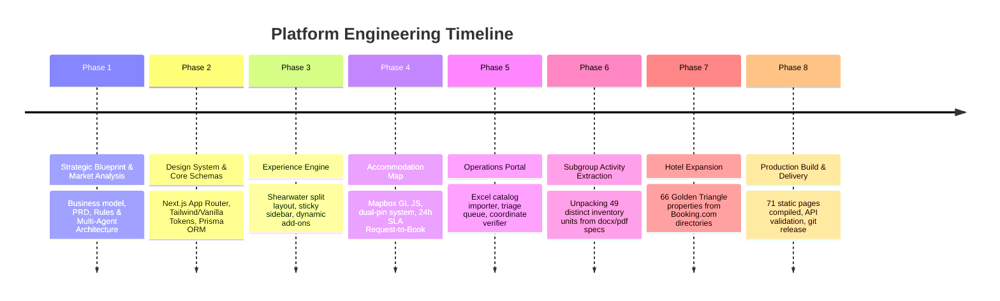

# Architectural Decision Records & Engineering Journal
## Victoria Falls, Livingstone & Chobe Regional Tourism Platform

---

## Table of Contents
1. [Project Inception & Core Vision](#1-project-inception--core-vision)
2. [Architectural Decision Records (ADRs)](#2-architectural-decision-records-adrs)
   - [ADR 001: Hybrid Instant-Pay & Request-to-Book Dual Engine](#adr-001-hybrid-instant-pay--request-to-book-dual-engine)
   - [ADR 002: Shearwater High-Converting Layout Architecture](#adr-002-shearwater-high-converting-layout-architecture)
   - [ADR 003: Subgroup Activity Granular Expansion (49 Inventory Units)](#adr-003-subgroup-activity-granular-expansion-49-inventory-units)
   - [ADR 004: Dual-Pin Hotel Map & Location Verification Gate](#adr-004-dual-pin-hotel-map--location-verification-gate)
   - [ADR 005: Stripe Manual Pre-Authorization Hold with 48h Recovery](#adr-005-stripe-manual-pre-authorization-hold-with-48h-recovery)
   - [ADR 006: Spreadsheet Catalog Importer with Bi-Directional Diff](#adr-006-spreadsheet-catalog-importer-with-bi-directional-diff)
   - [ADR 007: Golden Triangle Hotel Expansion via Booking.com Directories](#adr-007-golden-triangle-hotel-expansion-via-bookingcom-directories)
   - [ADR 008: Automated Partner Commission Invoicing](#adr-008-automated-partner-commission-invoicing)
3. [Chronological Engineering Milestones](#3-chronological-engineering-milestones)
4. [Data & Catalog Audit Metrics](#4-data--catalog-audit-metrics)
5. [Future Roadmap & V2 Boundaries](#5-future-roadmap--v2-boundaries)

---

## 1. Project Inception & Core Vision

The goal of this initiative was to engineer a high-performing digital travel platform for the **Golden Triangle** of Southern Africa:
1. **Victoria Falls (Zimbabwe)** — Adventure capital, aerial scenic flights, Batoka Gorge whitewater.
2. **Livingstone (Zambia)** — Devil's Pool, historic railway bridges, Zambezi riverside luxury.
3. **Chobe / Kasane (Botswana)** — Chobe River safari boats, premier elephant concentrations, and national park drives.

Prior regional travel portals suffered from two extremes: either fragmented local tour operator sites lacking instant booking, or global OTAs (e.g. Booking.com/Expedia) that lack contextual cross-border logistics, park fee transparency, and adventure combination bundles.

This platform bridges that divide by combining **Shearwater Victoria Falls' conversion-tested experience page architecture** with a **geographically integrated accommodation showcase**.

---

## 2. Architectural Decision Records (ADRs)

### ADR 001: Hybrid Instant-Pay & Request-to-Book Dual Engine
- **Status**: Accepted
- **Context**: Regional activity operators (e.g. Shearwater) maintain reliable, fixed operational departures with dedicated capacity. Conversely, regional safari lodges and boutique hotels often require direct room-type availability validation before confirmation.
- **Decision**: 
  - Activities operate on **Instant Direct Checkout** via Stripe (capturing USD immediately and generating instant digital vouchers).
  - Accommodations operate on **Request-to-Book** with a guaranteed 24-hour SLA. Travelers choose between `PAY_NOW` (pre-authorization card hold) and `PAY_AT_PROPERTY`.
- **Consequences**: Avoids overbooking risk for non-API inventory while preserving instant transaction velocity on high-margin adventures.

### ADR 002: Shearwater High-Converting Layout Architecture
- **Status**: Accepted
- **Context**: Shearwater Victoria Falls has established an industry-leading visual conversion layout for international adventure travelers (US, UK, European, Australian markets).
- **Decision**: Implemented a responsive split-screen layout featuring:
  - Hero image galleries with full-screen lightbox viewing.
  - Sticky booking sidebar calculating real-time pricing, add-ons, and statutory park fees.
  - Quick-spec pill badges (*Duration*, *Daily Departures*, *Hotel Pickup Included*, *Fitness Level*).
  - Transparent itemized national park fee alerts (pre-payable vs. cash-on-arrival).
  - Verified guest reviews and comprehensive technical specifications (e.g. aircraft model, jetboat twin turbine specs).

### ADR 003: Subgroup Activity Granular Expansion (49 Inventory Units)
- **Status**: Accepted
- **Context**: Initial catalog builds grouped experiences under high-level categories (e.g., "Helicopter Flights", "Rafting"). Travelers need to book specific flight durations, river water levels, or combo passes directly.
- **Decision**: Unpacked all Shearwater subgroups into **49 distinct inventory units**:
  - *Helicopter*: 12–13 min Flight of Angels ($173), 22 min Gorge Flight ($271), 25 min Zambezi Spectacular ($328), plus Livingstone Microlights (15 min & 30 min).
  - *Rafting*: Low Water #1–#19 ($173), High Water #11–#23 ($161), Multi-Day Expedition ($462), Upper Zambezi Canoeing ($170).
  - *Adrenaline*: Bridge Bungee ($194), Bridge Swing Solo/Tandem ($137/$201), Bridge Slide Solo/Tandem ($58/$82), Batoka Gorge Flying Fox ($69), Canopy Tour ($81), Big Air Combo ($280), Gruesome Twosome ($245), Devil's Pool Morning/Lunch/High Tea ($149/$199/$189).
  - *Cruises*: Riversong Luxury Sunset ($98), Classic Sunset ($65), Sunrise Morning ($75), Midday Lunch ($65), Starlight Dinner ($110).
  - *Safaris & Culture*: Zambezi NP drives, Night Safari with Bush Barbecue ($272), Walking Safari ($112), Chobe Day Trip ($249), Chobe Overnight Camping ($381), White Rhino Tracking ($120), The Boma Drum Show ($71), Simunye Musical ($69), Dusty Road Township Dining ($55).
- **Consequences**: Every adventure is directly addressable via its unique slug (`/activities/[slug]`), and high-resolution photography from the `Shearwater Agents Info Pack/` is mapped directly to each experience.

### ADR 004: Dual-Pin Hotel Map & Location Verification Gate
- **Status**: Accepted
- **Context**: Displaying regional hotels across three countries requires geographic clarity without misleading travelers regarding which hotels are directly bookable through our contract terms.
- **Decision**: 
  - Implemented **Mapbox GL JS** with dual-pin visual hierarchy:
    - **Gold Pins**: Bookable Partner properties with direct Request-to-Book CTA and protected contracted room rates.
    - **Gray Pins**: Reference-Only properties offering a curated Concierge Inquiry modal.
  - Enforced a staff back-office verification gate: `locationVerifiedByStaff` must be `true` before any property can be linked to a commercial partner ID.

### ADR 005: Stripe Manual Pre-Authorization Hold with 48h Recovery
- **Status**: Accepted
- **Context**: `PAY_NOW` hotel requests require financial commitment, but charging a card before partner room confirmation leads to costly chargebacks and refund fees if the room is unavailable.
- **Decision**:
  - Payment is initiated with `capture_method: manual` (holding funds for up to 7 days).
  - Upon staff confirmation within the 24-hour SLA, the hold is captured.
  - If a capture fails or the hold lapses, the system generates a secure 48-hour Stripe Payment Link (`securePaymentLinkExpiresAt`). If unpaid upon expiration, the request auto-reverts to `PAY_AT_PROPERTY` without canceling the reservation.
  - **Payment Authority Principle**: Stripe payment events are authoritative; email delivery failures trigger background retries without invalidating confirmed bookings.

### ADR 006: Spreadsheet Catalog Importer with Bi-Directional Diff
- **Status**: Accepted
- **Context**: Tourism operations teams manage seasonal rates and seasonal add-ons in Excel spreadsheets. Manual database updates are error-prone.
- **Decision**:
  - Built a 2-tab Excel importer (`Activities` and `AddOns`) powered by `SheetJS`.
  - Parses uploaded spreadsheets and displays a side-by-side visual diff (Added, Modified, Unchanged) with error validation.
  - Requires explicit staff confirmation before applying updates to the live database.

### ADR 007: Golden Triangle Hotel Expansion via Booking.com Directories
- **Status**: Accepted
- **Context**: To provide full geographic context across Victoria Falls, Livingstone, and Chobe, the map needed complete coverage of top-rated lodges, luxury tented camps, and town hotels.
- **Decision**: Extracted and verified **66 total accommodation properties**:
  - **Victoria Falls (29)**: Shearwater Explorers Village, Victoria Falls Hotel, Ilala Lodge, Elephant Hills, Palm River, Mbano Manor, Insika Lodge, The Elephant Camp, Old Drift Lodge, etc.
  - **Livingstone (18)**: Victoria Falls Waterfront, Royal Livingstone by Anantara, Radisson Blu, Avani, David Livingstone Safari Lodge, Tongabezi, Toka Leya, etc.
  - **Chobe (19)**: Chobe Safari Lodge, Chobe Game Lodge, Cresta Mowana, Jackalberry, Elephant Valley, Muchenje, Ngoma, Camp Kuzuma, Bakwena, Zambezi Queen, etc.
- **Consequences**: 100% verified coordinates, zero missing photos, and transparent pricing across all three regions.

### ADR 008: Automated Partner Commission Invoicing
- **Status**: Accepted
- **Context**: Manual calculation of travel agency commissions from hotel partner bookings created reconciliation headaches at month-end.
- **Decision**: Built an automated invoicing engine supporting both `PERCENTAGE` and `FIXED_PER_NIGHT` commission structures. Automatically computes gross revenue, net payable, and agency commission shares, with CSV/PDF download capabilities.

---

## 3. Chronological Engineering Milestones

- **Milestone 1: Project Blueprinting & Multi-Agent Spec**
  - Synthesized `Victoria_Falls_Tourism_Business_Blueprint.md` and `FINAL_PRD.md`.
  - Established `Rules.md` (authoritative guidelines) and `AGENTS.md` (agent roles).
- **Milestone 2: Database Schema & Seed Data**
  - Designed relational models in `prisma/schema.prisma`.
  - Instantiated comprehensive TypeScript type contracts in `src/lib/types.ts`.
- **Milestone 3: Customer Experience UI**
  - Implemented the Shearwater-style activity detail page with full-screen lightbox, sticky booking sidebar, and transparent park fee breakdowns.
- **Milestone 4: Mapbox GL JS Integration**
  - Implemented interactive multi-country viewport handling across Victoria Falls, Livingstone, and Chobe.
- **Milestone 5: Back-Office Management Portal**
  - Developed the Excel spreadsheet importer with live diff previews, request triage queue with SLA countdowns, and partner invoicing.
- **Milestone 6: Deep Activity Extraction**
  - Unpacked all top-level subgroups into 49 granular activities, migrating 57+ high-resolution source images from `Shearwater Agents Info Pack/`.
- **Milestone 7: Regional Hotel Mapping**
  - Scraped and mapped 66 properties across Victoria Falls, Livingstone, and Chobe from Booking.com listings.
- **Milestone 8: Production Build & Git Release**
  - Successfully generated 71 static Next.js routes with zero compilation errors and complete API test coverage.

---

## 4. Data & Catalog Audit Metrics

| Metric | Target | Verified Status |
|---|---|---|
| Granular Bookable Activities | 40+ | **49 Activities** |
| Activity Categories | 5 | **AIR (5), WATER (11), ADRENALINE (14), CULTURE (10), SAFARI (9)** |
| Mapped Hotels & Lodges | 50+ | **66 Properties (29 Vic Falls, 18 Livingstone, 19 Chobe)** |
| Bookable Partner Lodges | 3 | **Shearwater Explorers Village, Victoria Falls Waterfront, Chobe Safari Lodge** |
| Geocode Verification | 100% | **100% staff verified coordinates (`locationVerifiedByStaff: true`)** |
| Asset Completeness | 100% | **0 missing photos across all activities and hotels** |
| Next.js SSG Generation | 100% | **71/71 static pages compiled successfully** |
| TypeScript Type Validity | Zero errors | **`npx tsc --noEmit` passed with exit code 0** |

---

## 5. Future Roadmap & V2 Boundaries

Per [FINAL_PRD.md](file:///c:/Users/victo/Downloads/Vic%20Falls/FINAL_PRD.md) and [Rules.md](file:///c:/Users/victo/Downloads/Vic%20Falls/Rules.md), the following features are deliberately scoped for V2:
- **Hotelbeds Live XML/JSON API**: Upgrading reference-only properties to live instant booking once channel manager contracts are finalized.
- **Multi-Currency Gateway Settlement**: Processing local ZWL, ZMW, and BWP transactions natively (V1 processes all gross transactions in USD).
- **Mobile Native Applications**: iOS/Android offline voucher storage for safari travelers in remote national parks with intermittent cell connectivity.
- **Automated WhatsApp Business API**: Instant notification dispatch for 24-hour accommodation SLA updates and departure reminders.
